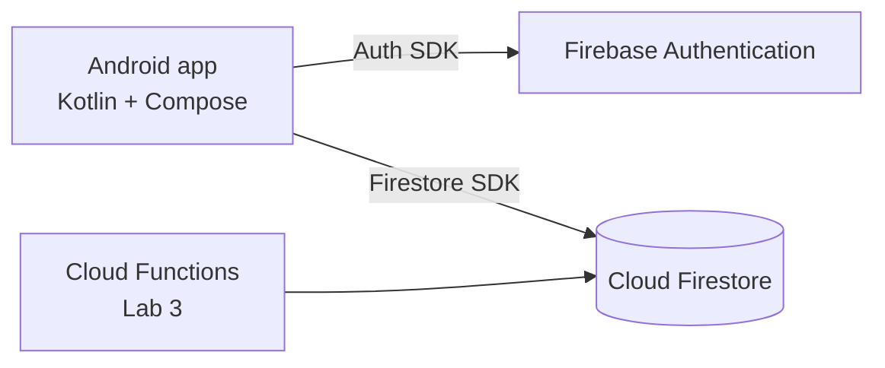

# GymBuddy

> Gym-goers forget what they trained and struggle to find training partners, so progress stalls and motivation drops.

GymBuddy lets you log workouts in the cloud, review your history, and find people to train with.

**Name:** Gym + Buddy. "Buddy" is gym slang for a training partner.
**Where it can be used:** individual gym-goers, friends and training groups, newcomers looking for a partner, university sports clubs, workplace wellness programmes and small gyms. More in [docs/planning/project-overview.md](docs/planning/project-overview.md).

## Team

| Member | Role |
|---|---|
| Aida Ismayilova (57689) | Product Owner + Developer |
| Ozodbek Tursunaliyev (57264) | Tech Lead + Developer |
| Elturan Valizada (58990) | QA / DevOps + Developer |

Everyone writes code; roles say who is accountable for a decision.

## MVP features

| # | Feature | Sprint |
|---|---|---|
| 1 | Register, log in, log out, auto-login (Firebase Auth) | 1 |
| 2 | List my workouts | 1 |
| 3 | Add / edit / delete a workout (detail/edit screen) | 1 |
| 4 | Weekly stats (Cloud Function) | later (Lab 3) |
| 5 | Find a training partner / join a session | later |

## Screens (5)

Login · Register · Workouts (home list) · Workout detail/edit · Partners (training sessions). Mockups: [docs/design/mockups](docs/design/mockups/00_overview.png).

## Data model (Cloud Firestore)

| Collection | Fields (type) |
|---|---|
| `users` | uid (doc id) · email (string) · displayName (string) · createdAt (timestamp) |
| `workouts` | ownerId (string) · title (string) · type (string) · durationMin (number) · notes (string) · date (timestamp) · createdAt (timestamp) |
| `sessions` | ownerId (string) · title (string) · gym (string) · startsAt (timestamp) · maxPeople (number) · participantIds (array of string) |

`ownerId` links a document to its owner; Security Rules (Lab 2) enforce that users only edit their own data.

## Architecture



Layers in the app: `data` (AuthRepository, the only code that talks to FirebaseAuth) → `domain` + `ui/auth` (AuthValidator, AuthViewModel) → `ui` (screens and navigation).

## Project structure

```
gymbuddy-app/
├── app/                      Android app (Kotlin + Compose)
│   └── src/
│       ├── main/java/com/ozodbek/gymbuddy/
│       │   ├── data/         AuthRepository, FirebaseAuthRepository
│       │   ├── domain/       AuthValidator
│       │   └── ui/           auth/, home/, navigation/
│       └── test/             unit tests (JUnit)
├── docs/
│   ├── planning/             problem statement, MVP, architecture, data model
│   ├── design/               UI mockups (+ generator script)
│   ├── sprint/               Sprint 1 user stories / issues
│   ├── presentation/         Lab 1 slides
│   └── TOOLS.md              tools used
├── gradle/                   version catalog (libs.versions.toml)
└── .github/                  pull request template
```

## Tools

| Phase | Tools |
|---|---|
| Planning & setup | Markdown, Mermaid, GitHub Issues and Projects, Git, GitHub, GitHub CLI |
| Design | Python + Pillow mockups |
| Development | Android Studio, Kotlin, Jetpack Compose, Navigation Compose, ViewModel and StateFlow, Coroutines, Gradle |
| Cloud backend | Firebase Authentication, Cloud Firestore, Security Rules, Cloud Functions (Lab 3) |
| Testing | JUnit, Android emulator |

Details: [docs/TOOLS.md](docs/TOOLS.md). Planning documents: [docs/planning](docs/planning).

## How to run

1. Open the project in Android Studio (latest stable) and let Gradle sync.
2. In the Firebase console, create a project, register an Android app with package `com.ozodbek.gymbuddy`, and put `google-services.json` into `app/`.
3. Enable Authentication → Sign-in method → Email/Password.
4. Run on an emulator with Google Play services.
