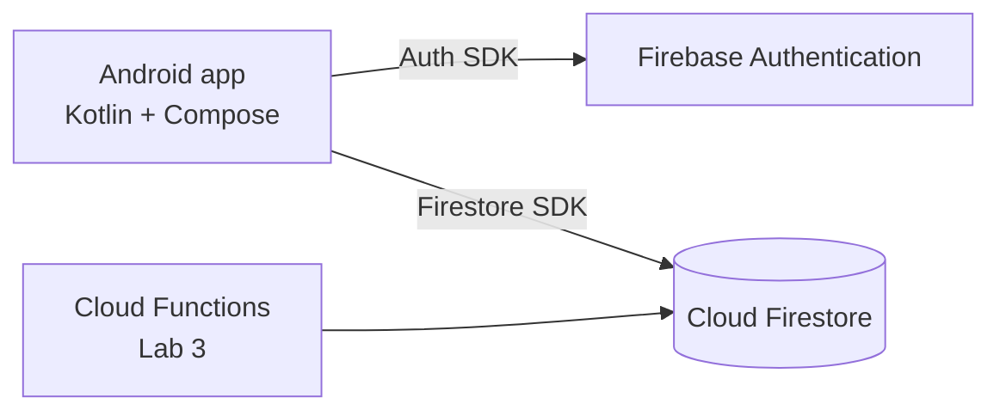

# GymBuddy

> Gym-goers forget what they trained and struggle to find training partners, so progress stalls and motivation drops.

GymBuddy lets you log workouts in the cloud, review your history, and find people to train with.

**Name:** Gym + Buddy. "Buddy" is gym slang for a training partner.
**Where it can be used:** individual gym-goers, friends and training groups, newcomers looking for a partner, university sports clubs, workplace wellness programmes and small gyms. More in [docs/planning/project-overview.md](docs/planning/project-overview.md).

## Team

| Member | Role |
|---|---|
| Aida Ismayilova (57689) | Product Owner + Developer |
| Ozodbek Tursunaliyev (57264) | Tech Lead + Developer |
| Elturan Valizada (58990) | QA / DevOps + Developer |

Everyone writes code; roles say who is accountable for a decision.

## MVP features

| # | Feature | Sprint |
|---|---|---|
| 1 | Register, log in, log out, auto-login (Firebase Auth) | 1 |
| 2 | List my workouts (live, only mine) | 1 (Lab 2) |
| 3 | Add / edit / delete a workout (one form, delete with confirmation) | 1 (Lab 2) |
| 4 | Weekly stats (Cloud Function) | later (Lab 3) |
| 5 | Find a training partner / join a session | later |

## Screens (5)

Login · Register · Workouts (list) · Workout form (create and edit) · Partners (later, not built yet). Mockups: [docs/design/mockups](docs/design/mockups/00_overview.png).

## Tech stack

| Layer | Choice |
|---|---|
| App framework | Kotlin + Jetpack Compose (Material 3), Navigation Compose |
| Backend | Firebase (free Spark plan) |
| Database | Cloud Firestore, with live snapshot listeners |
| Auth | Firebase Authentication (email and password) |
| Server-side access control | Firestore Security Rules (`firestore.rules`) |
| Test tools | JUnit (unit tests), Firebase Emulator Suite + `@firebase/rules-unit-testing` (rules tests) |
| Build | Gradle (version catalog), Android Studio |

## Data model (Cloud Firestore)

Two collections: the main `workouts` collection that users create, edit and delete, and the read-only reference collection `workoutTypes`. The "Set by" column says who writes each field: **user** (typed or picked in the form), **app** (code, from the session) or **server** (Firestore server clock).

**`workouts`**

| Field | Type | Set by |
|---|---|---|
| id | string (document id) | server |
| ownerId | string | app (uid of the signed-in user, never typed) |
| typeId | string (id in `workoutTypes`) | user (picks from the list) |
| typeName | string (copied for the list) | app |
| title | string, 1-60 characters | user |
| startAt | timestamp | user |
| endAt | timestamp, after `startAt` | user |
| notes | string, up to 200 characters | user |
| createdAt | timestamp | server (`serverTimestamp()`) |
| updatedAt | timestamp | server (`serverTimestamp()`) |

**`workoutTypes`** (reference data, read-only for users, at least 3 records)

| Field | Type | Set by |
|---|---|---|
| id | string (document id, for example `strength`) | team, in the console |
| name | string | team, in the console |
| sortOrder | number | team, in the console |

`ownerId` links a workout to its owner; the rules in `firestore.rules` make sure only the owner can read, change or delete it. The `users` and `sessions` collections from Lab 1 are not used yet (the partner finder comes later).

## Definition of Done

A story is done when it is merged to `main` through a reviewed PR, works on the device of a second team member, does not crash on invalid input and its issue is closed.

## Architecture



Layers in the app:

- `data`: `AuthRepository` / `WorkoutRepository` (interfaces) and their Firebase implementations. The only code that talks to the backend.
- `domain`: pure Kotlin with no UI, Android or backend imports: `AuthValidator`, `WorkoutValidator`, `WorkoutFilters`, `WorkoutStats`.
- `ui`: one state holder (ViewModel) per screen plus the screens and navigation. They get the repository through the constructor, so a fake can be passed in tests (Lab 3). `AppContainer` is the only place that creates the real repositories.

## Project structure

```
gymbuddy-app/
├── app/                      Android app (Kotlin + Compose)
│   └── src/
│       ├── main/java/com/ozodbek/gymbuddy/
│       │   ├── data/         repositories (+ model/ for Workout, WorkoutType)
│       │   ├── domain/       validators, filters, statistics (pure)
│       │   └── ui/           auth/, workouts/, navigation/
│       └── test/             unit tests (JUnit)
├── docs/
│   ├── planning/             problem statement, MVP, architecture, data model
│   ├── design/               UI mockups (+ generator script)
│   ├── sprint/               Sprint 1 user stories / issues
│   ├── presentation/         Lab 1 slides
│   └── TOOLS.md              tools used
├── firestore.rules           server-side access rules
├── rules-tests/              Security Rules tests (Firebase emulator)
├── gradle/                   version catalog (libs.versions.toml)
└── .github/                  pull request template
```

## Tools

| Phase | Tools |
|---|---|
| Planning & setup | Markdown, Mermaid, GitHub Issues and Projects, Git, GitHub, GitHub CLI |
| Design | Python + Pillow mockups |
| Development | Android Studio, Kotlin, Jetpack Compose, Navigation Compose, ViewModel and StateFlow, Coroutines, Gradle |
| Cloud backend | Firebase Authentication, Cloud Firestore, Security Rules, Cloud Functions (Lab 3) |
| Testing | JUnit, Android emulator, Firebase Emulator Suite (rules tests) |

Details: [docs/TOOLS.md](docs/TOOLS.md). Planning documents: [docs/planning](docs/planning).

## How to run

The Firebase project **`gymbuddy-ozodiy`** (free Spark plan) is already set up: the Android app is registered, `app/google-services.json` is in the repository, Email/Password sign-in is enabled, Cloud Firestore runs in the EU (`eur3`), the rules from `firestore.rules` are deployed, and the reference collection `workoutTypes` has four records (`strength`, `cardio`, `mobility`, `hiit`, each with `name` as a string and `sortOrder` as a number).

1. Open the project in Android Studio (latest stable) and let Gradle sync.
2. Run on an emulator with Google Play services.
3. Register two accounts and check that each one sees only its own workouts.

Team members need access to the Firebase project to use the console: Project settings → Users and permissions → add them as Editor (Aida, Elturan and the instructor).

### Set up your own Firebase project instead

1. In the [Firebase console](https://console.firebase.google.com) create a project (free Spark plan), register an Android app with package `com.ozodbek.gymbuddy`, and replace `app/google-services.json`.
2. Authentication → Sign-in method → enable Email/Password (or `firebase deploy --only auth`).
3. Create the database in an **EU** region (for example `eur3`): `firebase firestore:databases:create "(default)" --location eur3`.
4. Deploy the rules: `firebase deploy --only firestore`.
5. Create the collection `workoutTypes` with at least 3 documents, each with `name` (string) and `sortOrder` (**number**).

### Run the rules tests

```
cd rules-tests && npm install
cd .. && firebase emulators:exec --only firestore --project gymbuddy-rules-test "npm --prefix rules-tests test"
```
