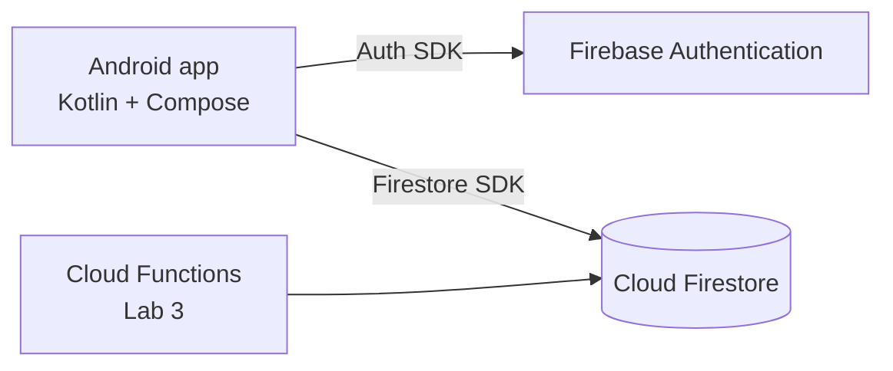

# Architecture

## Layers inside the app

| Layer | Package | Classes | Responsibility |
|---|---|---|---|
| Data | `data` | `AuthRepository`, `FirebaseAuthRepository` | The only code that talks to FirebaseAuth |
| Logic | `domain`, `ui/auth` | `AuthValidator`, `AuthViewModel` | Input validation, UI state (StateFlow), calls the repository |
| UI | `ui/auth`, `ui/home`, `ui/navigation` | `LoginScreen`, `RegisterScreen`, `HomeScreen`, `AppNavHost` | Show state, forward user actions |

Rules:
- Composables never call Firebase directly.
- Navigation reacts to `AuthViewModel.isLoggedIn`; screens never decide where to go after login.
- `AuthValidator` uses no Android classes, so it can be unit-tested on the JVM (Lab 3).
